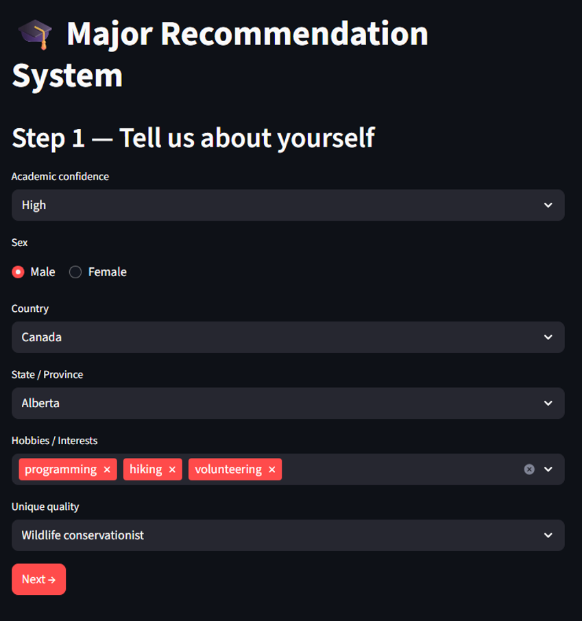
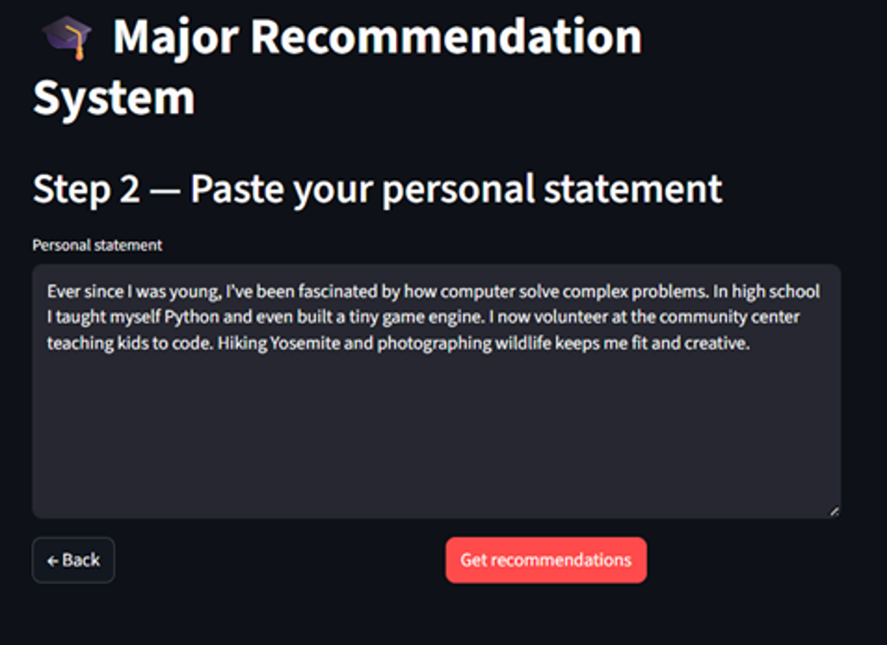
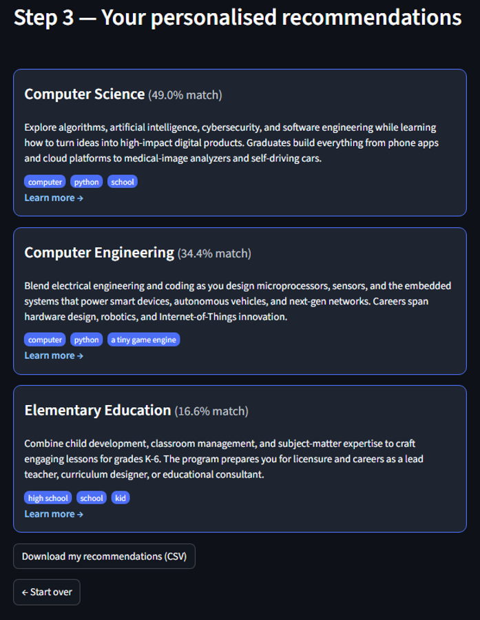

# Major Recommendation System

This is a Streamlit web application that uses Machine Learning and Natural Language Processing (NLP) to recommend university majors based on a student's personal statement and profile.

## Prerequisites

Before running the application, ensure you have Python installed. You will need to install the required libraries.

### Install Dependencies
Run the following command to install the necessary packages:

pip install streamlit pandas numpy scipy scikit-learn joblib spacy nltk sentence-transformers tf-keras

How to Run
Open your terminal or command prompt.
Navigate to the folder containing app.py
Run the Streamlit application:
streamlit run app.py

## Screenshots

### Step 1: User profile

### Step 2: Personal statement

### Step 3: Personalised recommendations

